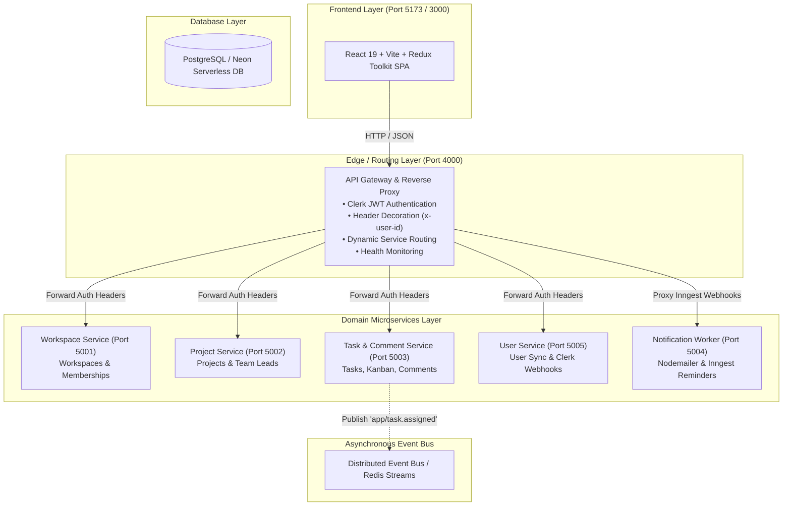

# 📋 TaskFlow — Microservices-Based Project Management Platform

## A modern, highly scalable full-stack project management application engineered using a **Microservices Architecture**, an **API Gateway**, an **Asynchronous Event-Driven Backbone**, and **Docker Container Orchestration**.

## 🌟 Key Features

- 🔐 **Edge Authentication** — Centralized Clerk JWT authentication and token validation at the API Gateway.
- 🏢 **Multi-Tenant Workspaces** — Workspace creation, custom slug generation, and role-based access control (`ADMIN` / `MEMBER`).
- 📁 **Project Management** — Milestone scheduling, progress tracking, deadline tracking, and team member assignment.
- ⚡ **High-Velocity Task Tracking** — Kanban status workflows (`TODO`, `IN_PROGRESS`, `DONE`), priority levels (`LOW`, `MEDIUM`, `HIGH`), and threaded comments.
- 📨 **Event-Driven Notifications** — Asynchronous task assignment emails and automated reminder workflows via Nodemailer and Inngest without blocking HTTP requests.
- 🐳 **Full Docker Orchestration** — Complete multi-container orchestration with Docker Compose, Redis event broker, and Nginx reverse proxy.

---

## 🏗️ System Architecture

TaskFlow decouples business logic across dedicated, single-responsibility microservices fronted by an API Gateway.



## 🚀 Getting Started

### Prerequisites

- Node.js and npm
- A PostgreSQL-compatible database (the project uses Neon)
- Clerk keys for authenticated frontend/API use
- Docker Desktop, if running with Docker Compose

### Configure environment

Create a root `.env` file:

```env
DATABASE_URL="your-pooled-database-connection-string"
DIRECT_URL="your-direct-database-connection-string"
CLERK_PUBLISHABLE_KEY="your-clerk-publishable-key"
CLERK_SECRET_KEY="your-clerk-secret-key"

# Optional: required for outbound notification emails
SMTP_HOST="smtp-relay.brevo.com"
SMTP_PORT="587"
SMTP_USER="your-smtp-user"
SMTP_PASS="your-smtp-password"
SENDER_EMAIL="your-sender-email"
```

Create the frontend environment file from the example and add your Clerk publishable key:

```sh
cp client/.env.example client/.env
```

Set `VITE_CLERK_PUBLISHABLE_KEY` in `client/.env`. The example `VITE_BASEURL` points to the local API Gateway.

### Install and run locally

From the project root:

```sh
npm install
npm run db:generate
npm run db:push
npm run dev:all
```

`npm run dev:all` starts the API Gateway, all five backend services, and the Vite frontend. Open the frontend URL printed by Vite (normally `http://localhost:5173`). To run only the backend services, use `npm run dev`; to run only the frontend, use `npm run dev:client`.

The API Gateway health endpoint is available at `http://localhost:4000/`. Backend services use ports `5001` through `5005`.

### Run with Docker Compose

After creating the root `.env` and `client/.env` files, run:

```sh
npm run docker:up
```

The app is served at `http://localhost:3000`. To stop the containers, run `npm run docker:down`.
